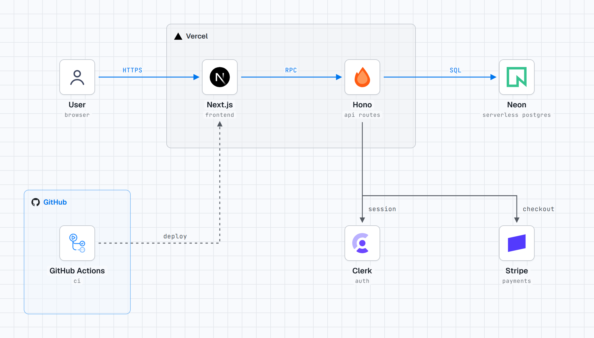
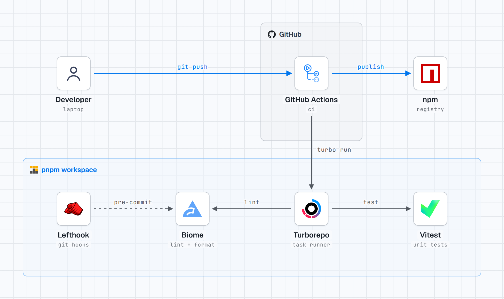
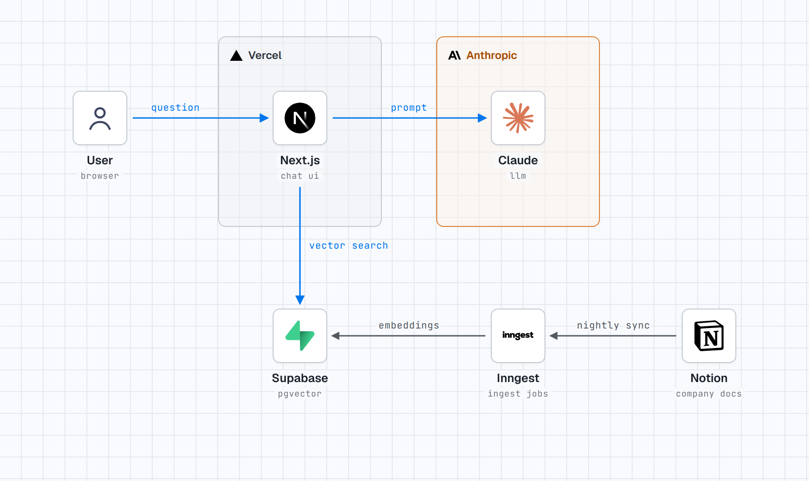
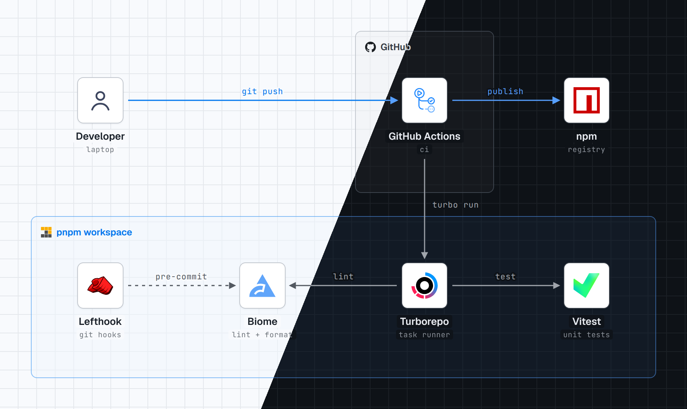
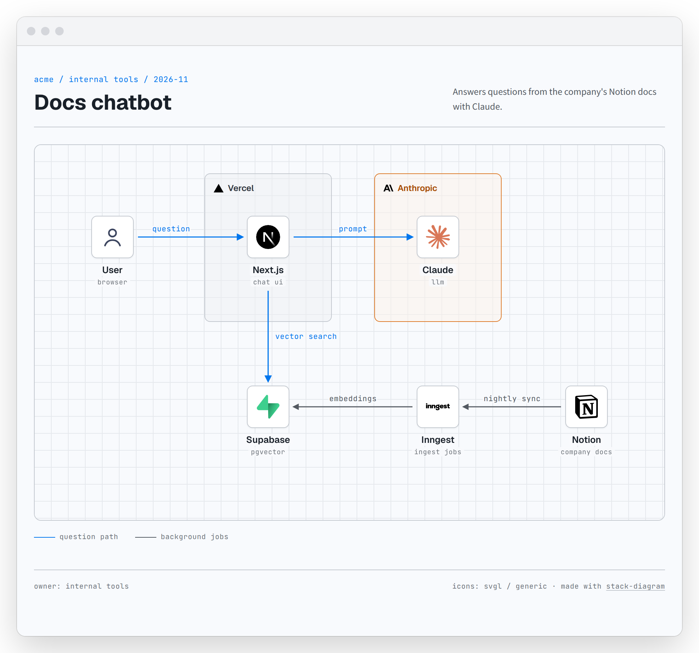

# stack-diagram

[](https://github.com/caru-ini/stack-diagram/releases/latest)
[](LICENSE)
[](https://skills.sh/caru-ini/stack-diagram)

Describe your stack in a sentence. Get an architecture diagram with official logos.

<picture>
  <source media="(prefers-color-scheme: dark)" srcset="docs/hero-dark.png">
  
</picture>

> Diagram our stack: Next.js on Vercel calls a Hono API on Cloudflare Workers. Postgres on Neon, auth with Clerk, files in R2, rate limiting with Upstash. GitHub Actions deploys.

```bash
npx skills add caru-ini/stack-diagram
```

Works with Claude Code, Codex, Cursor and [other agents that support skills](https://agentskills.io). In the Claude apps, upload `stack-diagram.zip` from [Releases](https://github.com/caru-ini/stack-diagram/releases/latest) as a skill.

## More examples

<table>
  <tr>
    <td width="50%" valign="top">
      <picture>
        <source media="(prefers-color-scheme: dark)" srcset="docs/tooling-dark.png">
        
      </picture>
      <p><b>Dev tooling, not just clouds</b></p>
      <blockquote>Draw our monorepo tooling: a pnpm workspace with Turborepo, Biome, Vitest and Lefthook. GitHub Actions runs CI and publishes to npm.</blockquote>
    </td>
    <td width="50%" valign="top">
      <picture>
        <source media="(prefers-color-scheme: dark)" srcset="docs/ai-dark.png">
        
      </picture>
      <p><b>AI apps</b></p>
      <blockquote>Draw our docs chatbot: Next.js on Vercel searches Supabase pgvector and answers with Claude. Inngest syncs Notion every night.</blockquote>
    </td>
  </tr>
</table>

## Light and dark

Every diagram is rendered in both themes. Tiles stay white so logos keep their own colors, and group labels switch to the brand's dark-theme logo.



## Share it as an artifact

The diagram is one HTML file with its fonts and logos inlined, so it renders anywhere without a network. Publish it as a Claude artifact and share the link, or drop it into a repo or wiki. The PNGs and the React component are rendered from the same file.

<picture>
  <source media="(prefers-color-scheme: dark)" srcset="docs/html-page-dark.png">
  
</picture>

## What you get

- **Official logos, fetched for you.** From [svgl](https://svgl.app), then [devicon](https://devicon.dev), then [gilbarbara/logos](https://github.com/gilbarbara/logos), or the brand's own repository. Never recolored or redrawn.
- **No arrows through text.** Lines are routed around labels, and the agent renders the diagram and checks it before handing it over.
- **The format you need.** A self-contained HTML file (default), PNG, a dependency-free React component, or an Artifact.

Requires Python 3.9+ and network access for the logos. PNG export uses Playwright with Chromium.

## Licenses and trademarks

- Code and docs: MIT — see `LICENSE`.
- Bundled fonts: SIL Open Font License 1.1 — see `skills/stack-diagram/assets/fonts/`.
- Logos are **not** bundled with the skill. They are downloaded at build time from [svgl](https://svgl.app), [devicon](https://devicon.dev) (MIT), [gilbarbara/logos](https://github.com/gilbarbara/logos) (CC0) and [Lucide](https://lucide.dev) (ISC), or from the brand's own site or repository. The example images in `docs/` show third-party logos. All brand names and logos are trademarks of their respective owners; their use in a diagram does not imply endorsement. The scripts never recolor or alter a logo.
